<!-- Texto digitando -->

  

<!-- Badges -->

  
  

---

###  Tecnologias

<b>Principais</b>

  

<table align="center">
  <tr>
    <td align="center"><b> Front-end</b></td>
    <td align="center"><b> Back-end & Dados</b></td>
    <td align="center"><b> Ferramentas</b></td>
    <td align="center"><b> Design & Vídeo</b></td>
  </tr>
  <tr>
    <td align="center"></td>
    <td align="center"></td>
    <td align="center"></td>
    <td align="center"></td>
  </tr>
</table>

---

###  Estatísticas

<!-- Os cartões "stats" e "months" são gerados pelo workflow em .github/workflows/snake.yml -->

  <picture>
    <source media="(prefers-color-scheme: dark)" srcset="https://raw.githubusercontent.com/Carlinhos09/Carlinhos09/output/stats-dark.svg" />
    
  </picture>
  <picture>
    <source media="(prefers-color-scheme: dark)" srcset="https://streak-stats.demolab.com?user=Carlinhos09&theme=github-dark-blue&hide_border=false&background=0d1117&border=30363d&ring=58a6ff&fire=3fb950&currStreakLabel=58a6ff&locale=pt_BR" />
    
  </picture>

---

  <picture>
    <source media="(prefers-color-scheme: dark)" srcset="https://raw.githubusercontent.com/Carlinhos09/Carlinhos09/output/github-snake-dark.svg" />
    <source media="(prefers-color-scheme: light)" srcset="https://raw.githubusercontent.com/Carlinhos09/Carlinhos09/output/github-snake.svg" />
    
  </picture>

